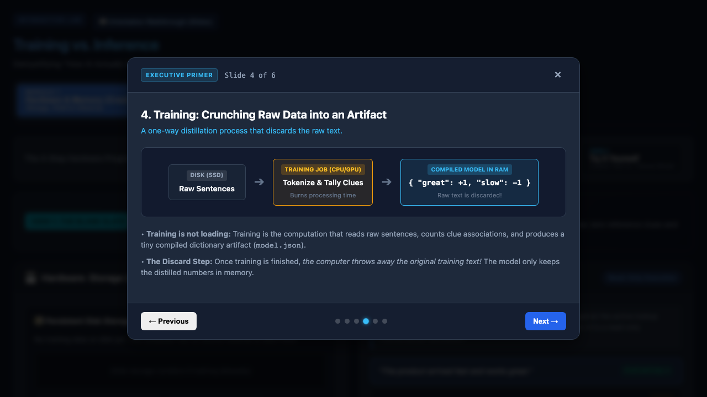
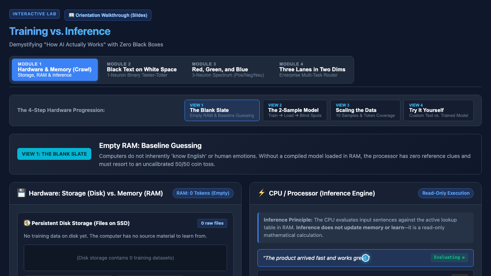
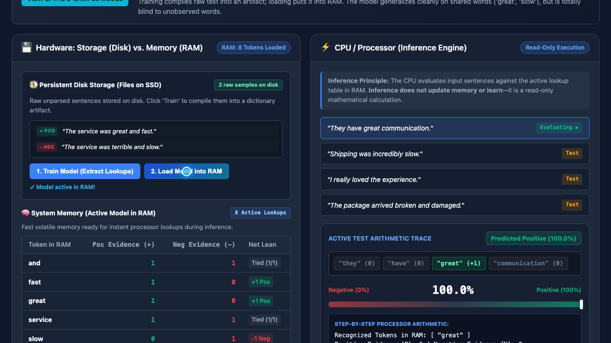
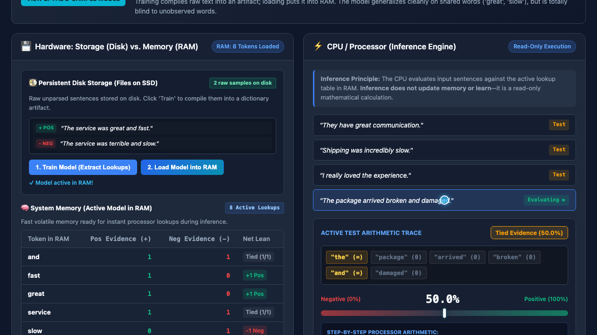
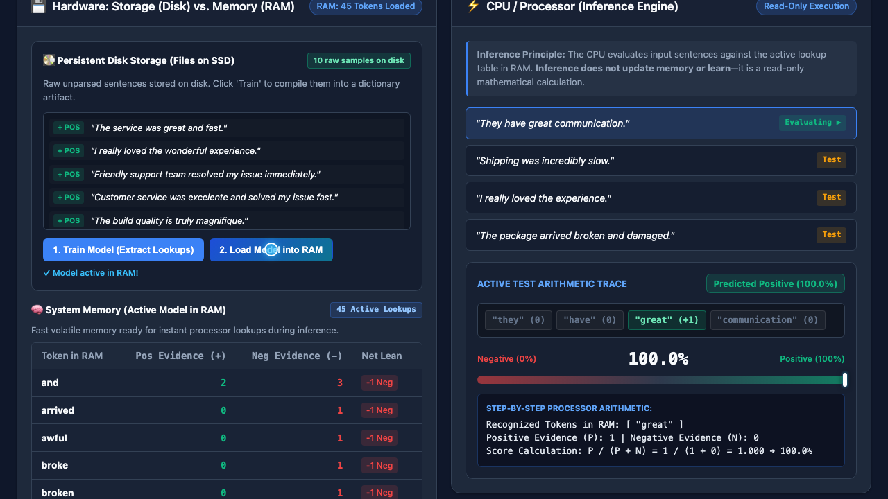
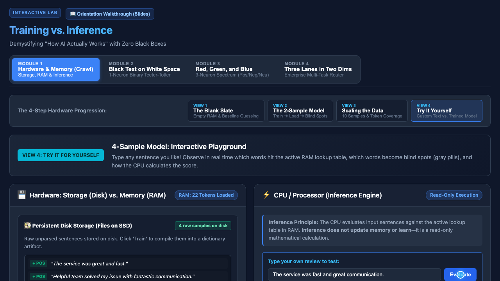

# Training vs. Inference — Interactive AI Learning Lab

> Demystifying "How AI Actually Works" — with zero black boxes.

**Live lab:** <https://tc.livive.net/> · **Repo:** <https://github.com/jpeckenpaugh/tc-livive-org>


---

An inspectable, browser-based learning lab that shows **how AI models learn and predict** by
walking through the actual hardware abstractions — disk storage vs. RAM, training vs. loading,
and read-only inference.

It was built for **business professionals and curious non-programmers** who want the real mental
model instead of magic. Every token tally, lookup, and score is rendered directly in the DOM as
plain, human-readable numbers.

## The core idea

A pocket calculator is a **computation** machine: a human wrote exact arithmetic rules, and it
executes them perfectly. Language has no such hand-written procedure — not one that covers every
sentence — so this lab learns the mapping from labeled examples through **training** instead.

The lab teaches this with four artifacts and two processes:

| Concept | What it is | Where it lives |
| --- | --- | --- |
| **Training Data** | Raw example sentences with known labels | Dormant files on **disk** |
| **Trained Model** | A tiny distilled lookup artifact | Compiled from disk |
| **Loaded Model** | The active lookup table | Live in **RAM** |
| **Inference** | Scoring a new, unseen sentence | Read-only **CPU** execution |

The key lessons: raw text on disk has **zero predictive power** until it is compiled; training
**discards the original text** and keeps only the distilled numbers; and inference **does not
learn** — it is a one-way calculation against whatever is in memory.

## Live demo

The app is deployed to GitHub Pages at a custom domain (**`tc.livive.net`**, via the `CNAME` file).

https://tc.livive.net/

### Gallery

| Orientation | Blank Slate | Train & Load |
| --- | --- | --- |
|  |  |  |

| Blind Spot (OOV) | Scaling Memory | Live Math Inspector |
| --- | --- | --- |
|  |  |  |

A 30-second, 720p walkthrough is included at [`demos/latest/demo.webm`](demos/latest/demo.webm).

## Curriculum

The app is organized as a four-module journey. Module 1 runs entirely in this repo. Modules 3 and
4 are **live chapters that hand off to [TROT](https://trot.livive.net/)** — the real Rust model
behind the story. Module 2 remains a placeholder.

| # | Module | Concept | Status |
| --- | --- | --- | --- |
| 1 | **Hardware & Memory** *(Crawl)* | Disk vs. RAM, train → load, blind spots | ✅ Implemented here |
| 2 | **Black Text on White Space** *(Walk)* | 1-neuron binary teeter-totter (sigmoid) | ⏳ Placeholder |
| 3 | **The Real Model** *(Jog)* | Rust MLP, real gradients, live trace | ✅ Chapter here → TROT |
| 4 | **The Artifact** *(Run)* | ONNX export, Netron, round-trip fidelity | ✅ Chapter here → TROT |

### Module 1 — the 4-view hardware progression

1. **The Blank Slate** — Empty RAM. With no trained model loaded, there is nothing to score
   against; the lab's baseline is **50%** — no better than a coin toss.
2. **The 2-Sample Model** — Train on two sentences, load the artifact into RAM, and watch the
   model generalize on shared words while ignoring tokens it never saw in training.
3. **Scaling the Data** — Retrain on 10 samples. Vocabulary coverage expands, blind spots close,
   and loanwords like *"excelente"* / *"magnifique"* appear as ordinary tokens.
4. **Try It Yourself** — Type any sentence and watch live which words hit the RAM lookup table,
   which become out-of-vocabulary gray pills, and exactly how the score is computed.

A **6-slide "Executive Primer"** orientation walkthrough (Computation vs. Inference, what a model
is, samples, training, inference, and the lab roadmap) auto-launches on the first visit.

## The next step: TROT

Crawl teaches the intuition with tally marks. **TROT — the Transparent Rust ONNX Trainer** —
supplies the machine. It is a separate project ([`trot-livive-net`](https://github.com/jpeckenpaugh/trot-livive-net),
live at [trot.livive.net](https://trot.livive.net/)) that trains a real MLP from scratch in Rust,
compiled to WebAssembly, in the browser.

Modules 3 and 4 in this lab are written chapters **about** TROT, in the same inspectable style as
Module 1 — side-by-side era comparison, the actual forward/backward code, the seeded corpus
grammar, ONNX graph anatomy, and the three proofs of artifact portability. The hands-on work then
happens in TROT itself, linked panel by panel.

- **Jog — the real model:** weights, gradients, and a traceable forward pass.
- **Run — the artifact:** a hand-written ONNX export, inspectable in Netron, verified by round-trip.

The lab stays static and dependency-free; the model, its Rust source, and its build live in TROT.

### Run it here, not just there

Module 4 is not a redirect. The repo ships the real artifact and a runner:

- [`models/trot.onnx`](models/trot.onnx) — the actual 1,939-byte ONNX file exported from the Rust core
- [`models/trot-vocab.json`](models/trot-vocab.json) — the 50-token vocabulary, in model order
- [`models/trot-ref.json`](models/trot-ref.json) — 25 input vectors and the Rust core's predictions
- [`onnx.js`](onnx.js) — a dependency-free protobuf reader and executor for `Gemm → Tanh → Gemm → Sigmoid`
- [`onnx-data.js`](onnx-data.js) — the same artifacts embedded (generated by `scripts/build-onnx-data.mjs`) so the page also works from `file://`

The **"Run the ONNX file — right here"** panel parses the bytes, executes the graph in JavaScript,
prints `z1`, `h`, `z2`, and `p`, and verifies 25 predictions against the Rust core (max difference
≈ `1e-7`). No ONNX Runtime, no CDN, no iframe.

## How it works

Everything runs client-side in vanilla JavaScript. No frameworks, no math libraries, no network
calls.

**1. Tokenize** — lowercase, strip punctuation, split on whitespace:

```js
function tokenize(text) {
  return text.toLowerCase().replace(/[^a-z0-9\s]/g, '').split(/\s+/).filter(Boolean);
}
```

**2. Train (compile to disk)** — count how often each token appears in positive vs. negative
samples, producing a compact artifact `{ token: { pos, neg } }`.

**3. Load** — deep-copy that artifact into the active RAM lookup table.

**4. Infer (read-only)** — for a new sentence, sum matched evidence:

- `P` = total positive hits, `N` = total negative hits
- If `P + N = 0` → **50.0%** (no clues in RAM)
- Else → **score = P / (P + N)**

Every step of that arithmetic is printed in the UI, alongside a gauge and color-coded token pills
(green = positive lean, red = negative lean, gray = out-of-vocabulary).

## Project structure

```
.
├── index.html               # Single-page app: layout, modules, walkthrough modal
├── style.css                # Dark dashboard theme (CSS variables, grid/flex)
├── app.js                   # Core engine: tokenizer, train/load/infer, UI bindings
├── onnx.js                  # Dependency-free ONNX reader + executor for trot.onnx
├── onnx-data.js             # Generated: embedded onnx bytes, vocab, reference probs
├── models/                  # trot.onnx, trot-vocab.json, trot-ref.json
├── scripts/                 # build-onnx-data.mjs (regenerates onnx-data.js)
├── favicon.ico
├── CNAME                    # tc.livive.net
├── run.sh                   # Serves the app locally on :8080
├── demos/latest/            # demo.webm + gallery/ screenshots + thumb.webp
├── test-runner/             # Dockerized Playwright smoke test + showcase recorder
└── *.md                     # Design specifications (see below)
```

## Running locally

No build step and no dependencies. Either open `index.html` directly, or serve it:

```bash
./run.sh              # python3 -m http.server 8080
# then open http://localhost:8080/
```

## Testing

A Dockerized Playwright smoke test drives the real UI through all four views and writes
screenshots plus a `results.json` report.

```bash
./test-runner/run.sh                 # fast smoke test
./test-runner/run.sh --showcase      # same, plus a recorded video
```

Artifacts land in `test-artifacts/` by default (override with `TEST_ARTIFACTS_DIR`). The
`--showcase` mode records the interactive run and is what regenerates the gallery/demo assets via
[`test-runner/record_showcase.py`](test-runner/record_showcase.py).

## Design principles

- **Zero black boxes** — every weight, tally, and calculation is visible in the DOM.
- **Zero dependencies** — plain HTML/CSS/JS; fully offline once loaded.
- **Hardware-first** — disk vs. RAM and training vs. inference are the mental models, not the
  math notation.
- **Honest failure modes** — blind spots, coin-toss baselines, and factual-neutral ambiguity are
  taught deliberately, not hidden.

## Design documents

The specs trace the design evolution and are the best source of deeper intent:

- [`concept_specification.md`](concept_specification.md) — original concept: sentiment classification
  and a Crawl / Walk / Jog pedagogical ladder.
- [`reframed.md`](reframed.md) — reframe around the four artifacts/processes and the disk → RAM story.
- [`spec_rev_2.md`](spec_rev_2.md) — revision 2: the 3-phase journey from a 1-neuron model to a
  multi-task enterprise head.

## Status

Actively developed. Module 1 is feature-complete and covered by the smoke test. Modules 3 and 4
are live chapters that link into TROT. Module 2 is still a placeholder, and the earlier
3-neuron / multi-head drafts remain conceptual extensions. See the commit history for the latest
work.

## License

No license has been specified for this project yet.
